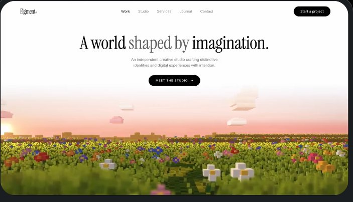
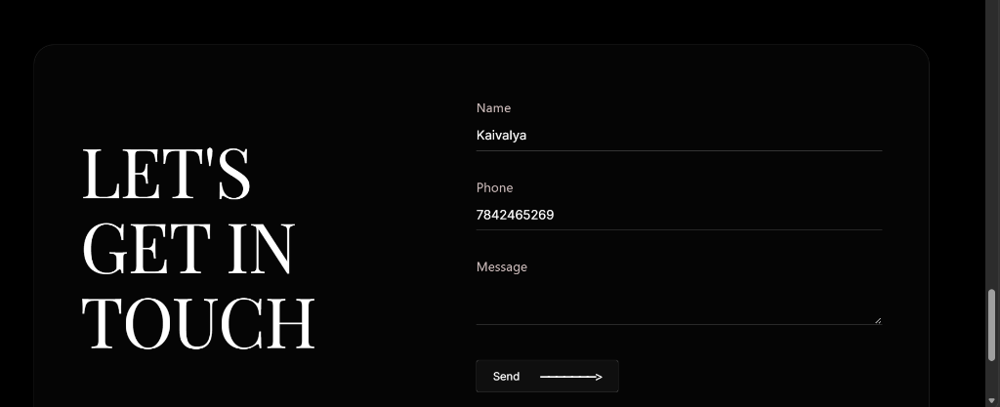
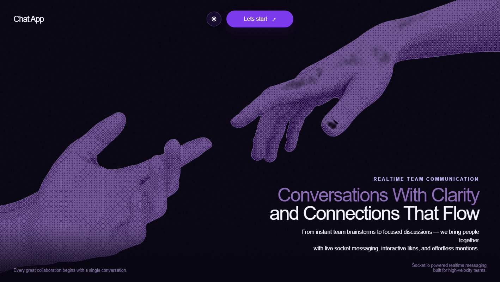
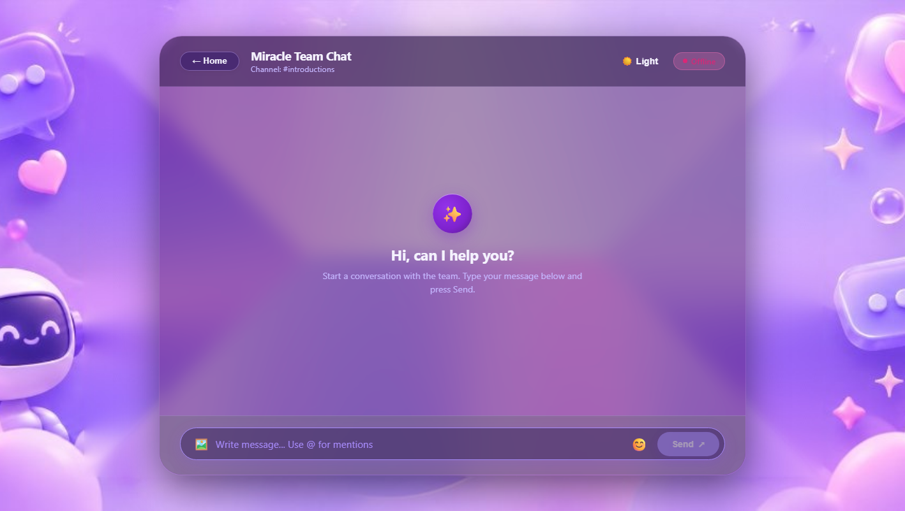

# React Assignments Submission

This repository contains the complete implementation for two React projects:

1. **Photo Gallery Application** (`photo-gallery/`)
2. **Realtime Team Chat Application** (`chat-app/`)

---

## 1. Photo Gallery (`photo-gallery/`)

A single-page, infinite scroll photo gallery built with React, Vite, and CSS Glassmorphism.

### Screenshots:

#### 1. Interactive 3D Voxel Sunset Hero (Zero-Scroll Lock)


#### 2. Seamless Flush Mosaic Grid (100% Full-Black Exhibition with Infinite Scroll)


#### 3. Frosted Glass Contact Section


### Key Features:
- **Interactive 3D Voxel Hero**: 3D interactive Sunset Meadow canvas (`MeadowBlush.tsx`) with zero-scroll landing lock and smooth cinematic entry.
- **Infinite Scrolling**: IntersectionObserver sentinel and scroll listener automatically fetches subsequent pages from the Picsum feed API with automatic fallback caching and deduplication.
- **Flush Mosaic Grid**: Seamless zero-gap photo grid with responsive layouts across desktops, tablets, and mobile devices.
- **Interactive Likes**: Real-time FontAwesome thumbs-up button incrementing per photo.
- **Lightbox Viewer**: Fullscreen modal with arrow and keyboard navigation.
- **Glassmorphic Contact Section**: Frosted glass card with ambient background glowing orbs.

### How to Run:
```bash
cd photo-gallery
npm install
npm run dev
```

---

## 2. Team Chat App (`chat-app/`)

A realtime chat application with WebSockets, mention support, emoji pickers, and glassmorphism UI.

### Screenshots:

#### 1. Originkit Hero 40 Section — Dark Theme (Dithered Visuals & Single "Lets start" Entry)


#### 2. Glassmorphic 3D Chat Interface — Dark Theme (Live Socket.io Messaging & Mentions)


### Key Features:
- **Originkit Hero 40**: Integrated Hero 40 section with dithered white-hands shader and seamless transition into the chat interface.
- **Full-Duplex WebSockets**: Express + Socket.io server broadcasting chat messages and live like counts.
- **Random User Assignment**: Automatically assigns a random username (`Alan`, `Bob`, `Carol`, `Dean`, `Elin`) to each message.
- **Message Likes**: Interactive like button at the end of each message with live count synchronization.
- **@ Mentions**: Typing `@` triggers an interactive user autocomplete dropdown.
- **Emoji Picker**: Popover emoji picker for quick insertions.
- **Light & Dark Themes**: Interactive sun/moon toggle affecting both Hero and Chat interfaces.
- **3D Glassmorphism Interface**: Single crisp translucent glass card overlaying clean 3D bubble wallpaper.

### How to Run:
```bash
cd chat-app
npm install

# Start the socket.io backend server (port 4000)
npm run server

# In a separate terminal, start the Vite client
npm run dev
```
